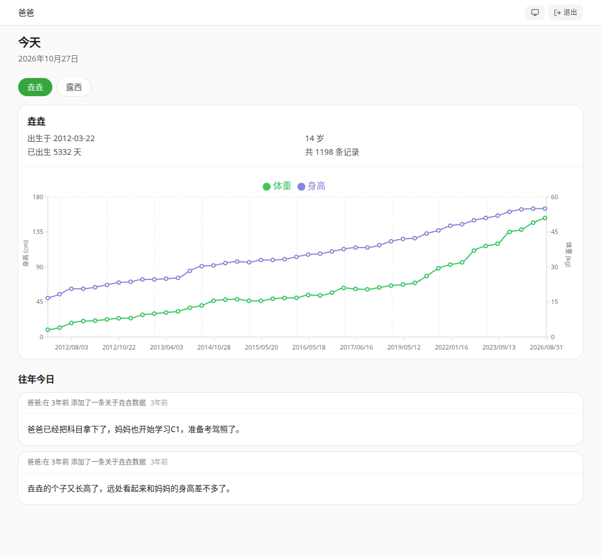
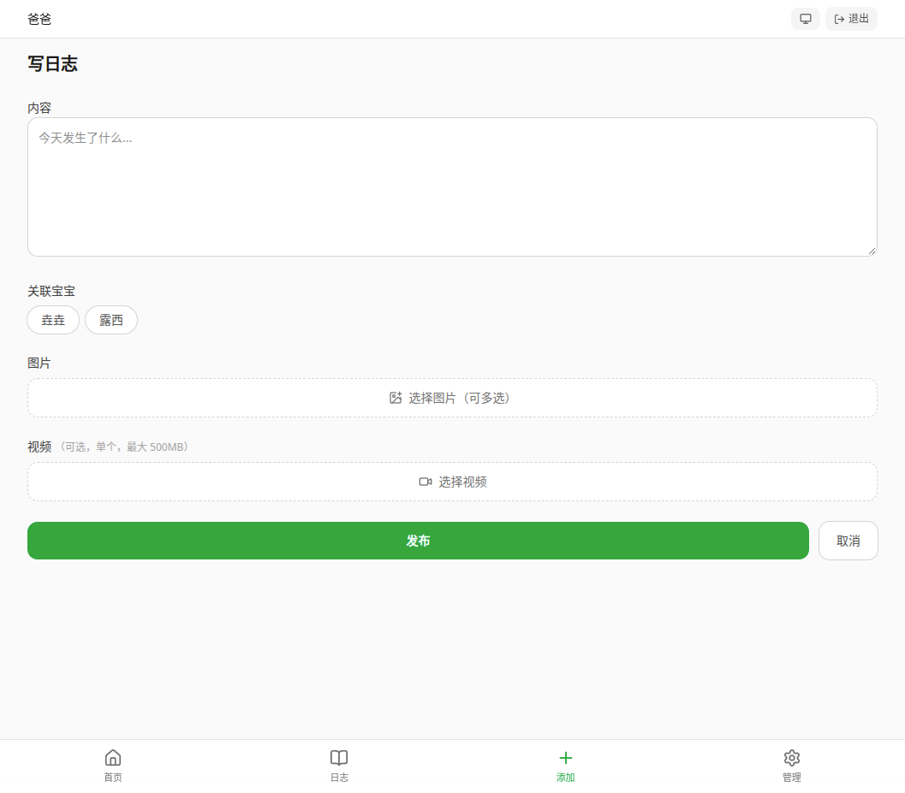
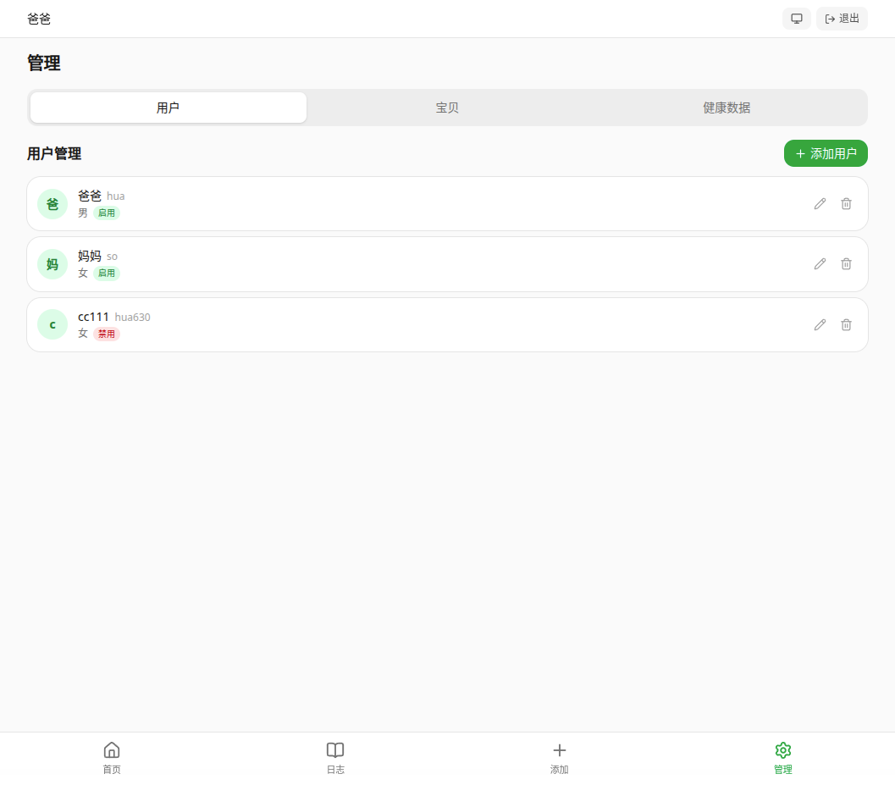
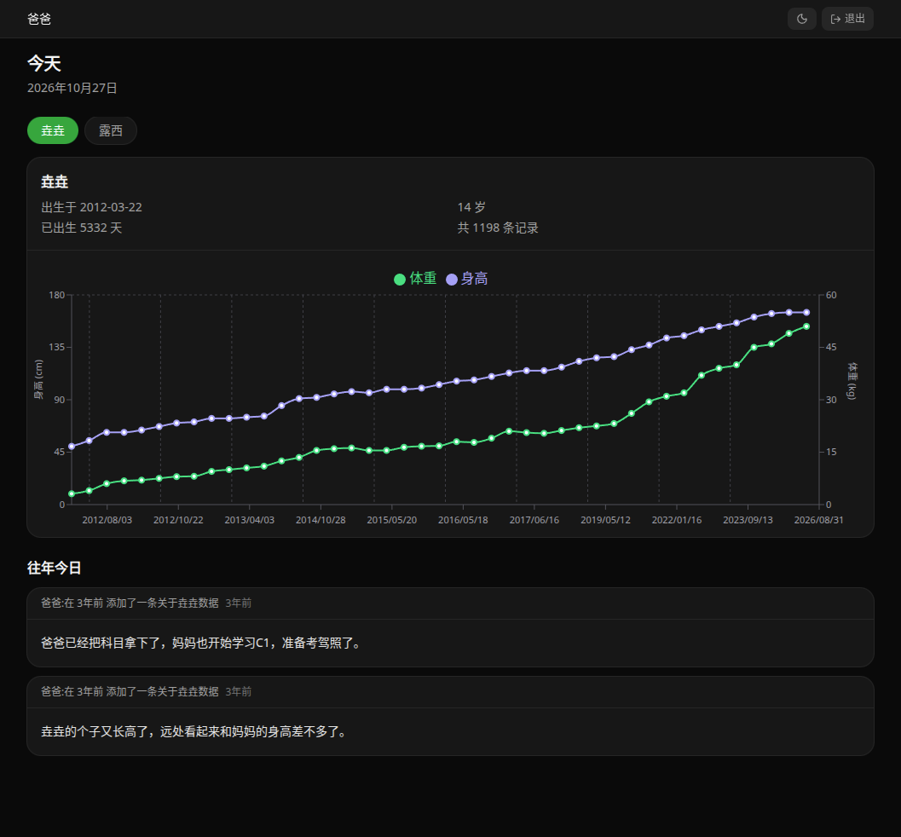

# BabyLog 3.1

岁月如风，唯有此忆, 任凭时光匆匆，记录点点滴滴。 

一晃14年都过去了,当初孩子出生的时候,我只是想记录一下一些当爸爸的心路历程,没想到一下子就过去了14年.

此间,程序重构过多次,但是唯一不变的就是那些记录下来的数据、相片和视频.

全新的BabyLog3.1发布了!


## 程序介绍

本程序采用现代化的前后端分离架构开发。

技术栈：
- 后端：Express.js、Sequelize、SQLite
- 前端：React、Vite、HeroUI、Tailwind CSS
- 视频处理：FFmpeg（自动转码为浏览器兼容的 MP4）

BabyLog 是用来记录孩子成长过程的日记，支持那年今天、关键字搜索、身高体重记录与图表展示。3.1 支持多个宝贝、多位家长亲属共同记录，日志内容支持文字、图片和视频。

### 主要功能

- **文字日志**：记录成长点滴，可关联多个宝贝，支持编辑和删除。
- **图片日志**：单篇日志支持多图上传和大图预览，图片按年份归档，删除日志时同步清理文件。
- **视频日志**：单篇日志支持 1 个视频，上传后自动转码为 MP4（H.264/AAC），宽度不超过 1920，最大 500MB，支持在线播放和拖动进度。
- **那年今天**：首页自动展示往年同一天的记录。
- **搜索与分页**：按关键字搜索日志，支持分页浏览。
- **成长记录**：记录身高、体重，并通过图表展示变化趋势。
- **多宝贝 / 多用户**：支持多个宝贝和多位家长亲属共同记录，注册用户需管理员启用。
- **移动端优先**：适配手机、平板和宽屏，支持 PWA 添加到主屏幕和暗黑模式。


## 项目结构

```text
BabyLog/
├── express_back/          # Express API 服务
│   ├── models/            # Sequelize 数据模型
│   ├── routes/            # API 路由
│   ├── middleware/        # 登录鉴权、密码哈希
│   ├── utils/             # 视频转码等工具
│   ├── uploads/           # 图片和视频文件（运行后生成）
│   └── babylog_data.db    # SQLite 数据库（运行后生成）
├── web_v2/                # React + Vite 前端
│   ├── src/
│   ├── public/
│   └── dist/              # 前端构建产物（npm run build 后生成）
├── skills/babylog/        # Agent 技能和命令行脚本
├── scripts/               # 数据库升级（upgrade_to_3_1.py）、测试脚本
├── imgs/                  # README 截图
├── start.js               # 启动前后端服务
├── stop.js                # 停止服务
├── control.js             # 交互式启动/停止/重启
├── start.bat              # Windows 启动脚本
├── install.js             # 安装前后端依赖
├── build-frontend.js      # 构建前端
├── SKILL.md               # Agent 技能说明
└── logs/                  # 运行时的 PID 文件
```


## 界面预览









支持暗黑模式




## 安装与部署

### 环境要求

- **Node.js**：20.19+ 或 22.12+（推荐 LTS）
- **npm**：随 Node.js 安装
- **FFmpeg / FFprobe**：视频上传、转码和视频信息读取必需
- **Python 3**：可选；Agent 技能的命令行脚本和旧数据库迁移脚本需要

FFmpeg 安装示例：

```bash
# Ubuntu / Debian
sudo apt install ffmpeg

# macOS
brew install ffmpeg

# Windows（winget）
winget install Gyan.FFmpeg
```

安装后重新打开终端，确认 `ffmpeg -version` 和 `ffprobe -version` 都能正常执行。

### 安装与启动

1. git克隆或是下载压缩包。

2. 一键安装所有依赖（前端和后端）：

    ```bash
    node install.js
    ```
3. 生产环境启动前必须构建前端：

    ```bash
    npm run build
    ```

    这个脚本会构建 `web_v2` 前端，产物输出到 `web_v2/dist`。如果尚未安装依赖，请先执行 `node install.js`。

4. 启动应用：

    生产环境启动：
    ```bash
    node start.js
    ```
    或
    ```bash
    npm start
    ```

    开发环境启动：
    ```bash
    node start.js --dev
    ```
    或
    ```bash
    npm run dev
    ```

    这将同时启动前端和后端服务：
    - 后端API服务运行在: http://localhost:8888
    - 前端服务运行在: http://localhost:3000
      （开发环境为 Vite 开发服务器，生产环境使用 Vite Preview 托管 `web_v2/dist`）

    启动后在浏览器打开 http://localhost:3000 即可使用。

5. 停止服务：

    ```bash
    node stop.js
    ```

    也可以运行 `node control.js`，交互式选择停止或重新启动服务。

> Windows 用户完成依赖安装和前端构建后，也可以双击 `start.bat` 启动。停止时可以关闭启动窗口；`stop.js` 的端口清理主要面向 Linux/macOS。

### 更新版本

更新已有部署时，先停止服务，再拉取代码、安装依赖并重新构建：

```bash
node stop.js
git pull
node install.js
npm run build
node start.js
```

如果新版本包含数据库结构变化，请先不要执行最后的 `node start.js`，而是按下面的升级章节备份并完成迁移。

### 从任意 3.1 之前的版本升级

> **重要：只要数据库不是 3.1，就按完整升级处理：检查/迁移字段名，并确保 `video` 表存在。** 3.0 及更早版本不要只运行 `migrate_video_table.py`；它只补 `video` 表，不会检查字段名。必须使用完整升级脚本，脚本会自动判断哪些字段需要改名。不确定版本时直接运行脚本即可。

升级前先停止服务，并备份数据库和上传文件：

```bash
node stop.js
tar czf babylog-before-upgrade-$(date +%Y%m%d).tar.gz express_back/babylog_data.db express_back/uploads
```

推荐使用统一升级脚本。它会先检查并迁移字段名，再创建 `video` 表，然后校验行数/内容/外键，并在替换前备份原数据库：

```bash
# 1. 先生成 express_back/babylog_data.new.db 并查看校验结果（不替换）
python3 scripts/upgrade_to_3_1.py

# 2. 确认无误后应用；会自动备份原库为 babylog_data.db.bak-时间戳
python3 scripts/upgrade_to_3_1.py --apply
```

脚本处理的字段/表包括：

- `user.familymember` -> `family_member`
- `user.sex` -> `gender`（男/女/1/2 -> male/female）
- `user.create_time/update_time` -> `created_at/updated_at`
- `blog.blog` -> `content`
- `blog.create_time/update_time` -> `created_at/updated_at`
- `healthy` -> `health_record`
- `healthy.create_time/update_time` -> `health_record.created_at/updated_at`
- `photo.file_path` -> `storage_path`
- 新建 `video` 表及索引

如果已经是 3.1，脚本会提示“无需升级”。全新安装也无需执行升级脚本，后端首次启动会自动创建 3.1 表结构。升级完成后启动：

```bash
node start.js
```

`scripts/migrate_schema.py` 保留为兼容入口，效果相同。`scripts/migrate_video_table.py` 仅用于字段名已经是 3.1、只缺 `video` 表的修复场景；如果字段名还没升级，它会直接提示你先运行完整升级脚本，不要用它代替完整升级。

#### 建议让 AI 协助升级

数据库是多年的家庭记录，升级前建议让 AI Agent 参与，不要只看脚本最后一行。可以让 AI：

1. 对比旧库和当前 3.1 模型的表、字段、索引；
2. 先运行不带 `--apply` 的升级脚本，生成新库；
3. 核对每张表行数、`blog` 内容总长度/哈希、`photo`/`video` 路径、外键完整性；
4. 确认无误后再执行 `--apply`，启动后检查日志和页面。

可直接复制下面的提示词给 AI：

```text
请作为 BabyLog 数据库升级助手，协助我把数据库升级到 3.1。

项目目录：<填写项目路径>
旧数据库：express_back/babylog_data.db
目标结构：3.1（字段名规范化 + video 表）

要求：
1. 先备份数据库和 express_back/uploads；
2. 对比旧库与 3.1 模型的表名、字段名、索引；
3. 运行 python3 scripts/upgrade_to_3_1.py（先不要加 --apply），把完整输出给我；
4. 核对每张表行数、blog 内容总长度/哈希、photo/video 路径、外键；
5. 我确认后再运行 python3 scripts/upgrade_to_3_1.py --apply；
6. 最后运行 node start.js，检查后端日志和页面数据。
```

### 数据备份

需要备份以下内容：

- 数据库：`express_back/babylog_data.db`
- 图片：`express_back/uploads/<年份>/`
- 视频：`express_back/uploads/videos/<年份>/`

备份前建议先停止服务，避免复制到正在写入的数据库：

```bash
node stop.js
tar czf babylog-backup-$(date +%Y%m%d).tar.gz express_back/babylog_data.db express_back/uploads
node start.js
```

恢复时先停止服务，解压覆盖对应文件，再重新启动：

```bash
node stop.js
tar xzf babylog-backup-YYYYMMDD.tar.gz
node start.js
```

Windows 下如果没有 `lsof`，请先关闭 `start.bat` 启动窗口，再手动复制数据库和 `express_back/uploads` 目录。


## 初始账号

如果数据库中还没有用户，首次启动会创建管理员账号：`admin` / `123456`。登录后可在底部导航的「管理」中修改密码、维护家庭成员和宝贝信息，然后开始记录。


## 使用说明

### 添加日志

1. 登录后点击底部导航的「添加」。
2. 选择关联的宝贝，输入文字内容。
3. 点击「选择图片（可多选）」可以上传多张图片；点击「选择视频」可以上传 1 个视频，单个视频最大 500MB。
4. 视频上传后会自动转码为浏览器兼容的 MP4，等待上传和转码完成后再点击「发布」。大文件可能需要 1 分钟以上，请保持页面打开。

### 编辑与删除

- 在日志列表中可以编辑或删除日志。
- 编辑时可以增删图片、更换或移除视频。
- 删除日志会同时删除关联的图片和视频文件。

### 浏览与搜索

- 首页展示宝贝信息、成长曲线和「往年今日」。
- 「日志」页按时间倒序展示记录，支持关键字搜索和分页浏览。

### 管理

底部导航的「管理」中可以维护宝贝信息、家庭成员、身高体重记录，并修改个人资料。

### 注册与成员管理

家庭成员可以在登录页点击「注册」创建账号，注册后默认是停用状态。管理员在「管理 → 用户」中启用后即可登录。


## 局域网访问

`start.js` 默认让前端监听 `0.0.0.0`，同一局域网内的手机、平板可以访问：

```text
http://<服务器局域网IP>:3000
```

注意事项：

- 防火墙只需要开放 3000；8888 是内部 API 端口，不建议直接暴露到公网。
- 普通 HTTP 下浏览器可以访问，但 PWA“添加到主屏幕”通常需要 HTTPS（`localhost` 除外）。
- 公网访问请放在 HTTPS 反向代理后面。如果反向代理到前端 3000 端口，Vite Preview 会继续转发 `/v1` 和 `/uploads`；如果使用 Nginx 拆分前后端，需要由 Nginx 托管 `web_v2/dist`，并转发 `/v1` 和 `/uploads` 到后端。
- 视频上传较大，反向代理需要设置 `client_max_body_size 500m` 和至少 10 分钟的上传/读取超时。


## Agent 技能

本项目提供通用的 Agent 技能，技能说明位于根目录 `SKILL.md`，操作脚本位于 `skills/babylog/scripts`。支持各类智能体（Agent）使用，例如 OpenClaw、Hermes 等。安装技能后，AI 助手即可通过自然语言操作宝贝日记。

### 安装

将本项目根目录配置为 Agent 的技能目录即可：根目录的 `SKILL.md` 会被识别为技能说明，脚本保留在 `skills/babylog/scripts`。

以 OpenClaw 为例，可以将项目根目录链接到技能目录：

```bash
ln -s "/path/to/BabyLog_自家使用版本" ~/.openclaw/workspace/skills/babylog
```

也可以在你的 Agent 配置中，直接将技能路径指向本项目根目录。

### 首次使用配置

首次让 Agent 操作 BabyLog 前，先让它根据实际部署位置完成目录和数据库路径配置。可以直接发送下面的指令：

> 请读取项目根目录的 `SKILL.md`，完成 BabyLog 首次配置：
> 1. 确认 BabyLog 项目根目录的绝对路径；
> 2. 确认 SQLite 数据库路径，默认为 `<项目根目录>/express_back/babylog_data.db`；
> 3. 确认技能脚本目录，默认为 `<项目根目录>/skills/babylog/scripts`；
> 4. 确认可用的 Python 命令（`python3` 或 `python`）；
> 5. 检查数据库文件是否存在并且可读写。
> 配置完成后，请把实际使用的路径和检查结果告诉我，后续操作都使用这些路径。

Agent 确认后，会在后续操作中使用实际的项目路径、数据库路径和脚本路径；如果实际路径与默认值不同，以 Agent 确认后的路径为准。

### 使用

安装或配置好技能后，直接在任意支持技能的 Agent 中对话即可：

**添加日志**：
- "给小明添加日志，内容是今天小明很开心"
- "给小明和小红添加日志，内容是全家去公园玩"
- "给小明添加日志，内容是xxx。添加者是妈妈"

**搜索日志**：
- "返回最近10条日志"
- "返回小明最近10条日志"
- "给我5条关于小明的哭的日志"

**修改日志**：
- "把日志1184的内容全部替换成新内容"
- "修改日志1184，把"打篮球"改成"踢足球""
- "在日志1184后面追加，后来他们玩得很开心"

> 当前 Agent 技能和命令行脚本主要支持文字日志的添加、搜索和修改；图片、视频请通过 Web 界面添加。

---

## 命令行脚本

也可以直接使用命令行脚本操作文字日志数据。以下命令中的 `python` 请按你的环境替换为 `python3`。

### 添加日志

```bash
python skills/babylog/scripts/add_blog.py --content "日志内容" --babies "露西" --author "爸爸"
```

参数：
- `--content, -c`：日志内容（必填）
- `--babies, -b`：宝宝名称，多个用逗号分隔（必填）
- `--author, -a`：添加者，家庭成员称呼，默认"爸爸"

### 搜索日志

```bash
# 最近10条日志
python skills/babylog/scripts/search_blog.py

# 最近20条日志
python skills/babylog/scripts/search_blog.py --limit 20

# 指定宝宝的日志
python skills/babylog/scripts/search_blog.py --baby "露西"

# 关键字搜索
python skills/babylog/scripts/search_blog.py --keyword "哭"

# 组合搜索
python skills/babylog/scripts/search_blog.py --baby "露西" --keyword "测试"
```

参数：
- `--limit, -l`：返回数量，默认10条
- `--baby, -b`：宝宝名称筛选
- `--keyword, -k`：关键字搜索

### 修改日志

```bash
# 全量替换
python skills/babylog/scripts/edit_blog.py --id 123 --replace "全新的内容"

# 部分替换（查找并替换）
python skills/babylog/scripts/edit_blog.py --id 123 --find "原内容" --replace "新内容"

# 追加内容
python skills/babylog/scripts/edit_blog.py --id 123 --append "追加的内容"

# 同时更新宝宝关联
python skills/babylog/scripts/edit_blog.py --id 123 --replace "新内容" --babies "露西,垚垚"
```

参数：
- `--id, -i`：日志ID（必填）
- `--replace, -r`：替换内容（全量替换或部分替换的新内容）
- `--find, -f`：查找内容（部分替换时使用）
- `--append, -a`：追加内容
- `--babies, -b`：新的宝宝关联，多个用逗号分隔（可选）

---

## API 概览

API 默认运行在 `http://localhost:8888/v1`。除登录和注册外，请求需要携带：

```text
Authorization: Bearer <token>
```

| 模块 | 路径 | 说明 |
| --- | --- | --- |
| 认证 | `/v1/auth` | 登录、注册 |
| 用户 | `/v1/users` | 用户管理 |
| 宝贝 | `/v1/babies` | 宝贝管理、日志数量统计 |
| 日志 | `/v1/blogs` | 添加、搜索、编辑、删除、往年今日 |
| 图片 | `/v1/photos` | 上传、删除 |
| 视频 | `/v1/videos` | 上传转码、删除 |
| 健康 | `/v1/healthies` | 身高体重记录 |

前端通过 `/v1` 相对路径访问 API，开发和生产环境的代理配置见 `web_v2/vite.config.ts`。

---

## 常见问题

### 页面打不开或白屏

- 生产环境必须先执行 `npm run build`，并确认 `web_v2/dist/index.html` 存在。
- 检查 3000 和 8888 端口是否被占用，先执行 `node stop.js` 再重新启动。
- 查看 `node start.js` 的终端输出，确认前端和后端都已启动。

### 视频上传失败

- 确认已安装 FFmpeg：`ffmpeg -version`、`ffprobe -version`。
- 确认视频不超过 500MB。
- 转码失败时终端会输出具体错误，检查视频文件是否完整、磁盘空间是否充足。

### 注册后无法登录

新注册用户默认是停用状态，需要管理员在「管理 → 用户」中启用。

### 图片或视频不显示

- 确认 `express_back/uploads` 存在且可写。
- 如果使用反向代理，需要同时转发 `/v1` 和 `/uploads`。
- 确认上传文件没有被手动移动或删除。

### 端口被占用

```bash
node stop.js
node start.js
```

如果仍然被占用，检查是否有其他程序占用了 3000 或 8888。

### Node.js 版本报错

请使用 Node.js 20.19+ 或 22.12+；版本过低会导致前端构建失败。


## 安全建议

- 首次登录后立即修改默认管理员密码 `admin` / `123456`。
- 不要直接把 8888 或 3000 暴露到公网；公网访问请使用 HTTPS 反向代理。
- 定期备份数据库和 `express_back/uploads`。
- `JWT_SECRET` 当前写在 `express_back/middleware/auth.js` 中，公网部署前请改成强随机值。可以用下面的命令生成：

  ```bash
  node -e "console.log(require('crypto').randomBytes(32).toString('hex'))"
  ```

- 当前 CORS 允许所有来源，公网部署时建议按实际域名限制。


## 贡献

欢迎提交 Issue 和 Pull Request。提交前请注意：

- 不要提交 `express_back/babylog_data.db`、`express_back/uploads/` 等个人数据。
- 数据库结构变更请同时提供迁移脚本。
- 提交前先备份数据，并尽量使用测试数据验证。


## 许可证

本项目基于 [Apache License 2.0](./LICENSE) 开源。


## 写在最后

这个程序自己真的是使用了好多年，历经几次的重构，从最开始的php原生代码到使用thinkPHP框架，后来有使用Java重构了一次（详见分支master），期间还用Python写了一个终端的录入版，而后使用了flask重构了一下，这次 3.1 版本使用前后端分离架构，采用Express.js作为后端、React + Vite作为前端，使用了现代化的UI组件和响应式设计。这个程序使用也有14年多了，回头看看真是感慨万千，一方面是孩子的记录，一方面是自己学习的渣渣历程。

真诚的希望有孩子的和打算生孩子的程序员们来一起维护这个程序，有些东西真的需要记下来，不然回头看去都是模糊的回忆。

任凭时光匆匆，记录点点滴滴。以上记录于2026-10-27
   


